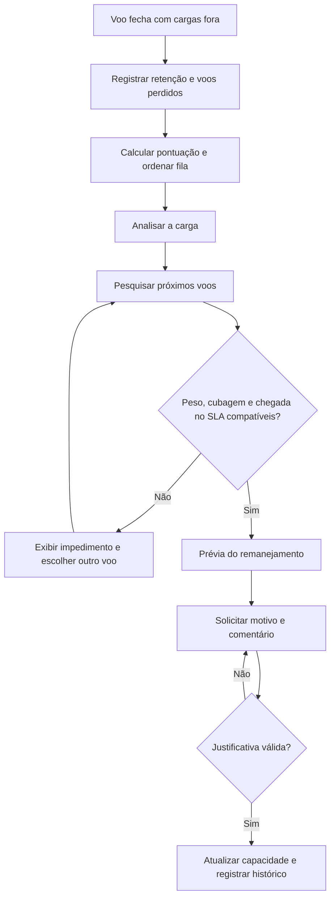

# Realoca - Gestão de cargas represadas | FIAP x Azul

> Estudo acadêmico de análise de negócios, prototipação e validação de regras para remanejamento de cargas no terminal de Viracopos.

## Desafio

Evitar que cargas de prioridade média ou baixa permaneçam repetidamente em aguardo sem rastreabilidade, aumentando o risco de descumprimento do SLA de **chegada ao destino**.

## Funcionalidades essenciais

1. Análise de cargas em aguardo, com motivo, histórico de voos perdidos e pontuação.
2. Avaliação de capacidade (peso e cubagem) e remanejamento para outro voo.
3. Registro obrigatório de justificativa e histórico da decisão.

## Processo TO BE

## Telas estudadas

Sete quadros visuais foram analisados: fila de cargas; análise; voos; remanejamento; erro de capacidade; justificativa; registro concluído. O arquivo final corrigido no Figma não foi disponibilizado nesta conversa para inclusão neste pacote.

## Regras e indicadores

- [Resumo das regras e exceções](docs/regras-e-excecoes.md)
- [Indicadores de impacto](docs/indicadores.md)

## Observações

Este é um projeto acadêmico independente, sem integração aos sistemas da Azul. Os dados de cargas e voos são fictícios. Não há endosso ou sistema de produção da companhia.

